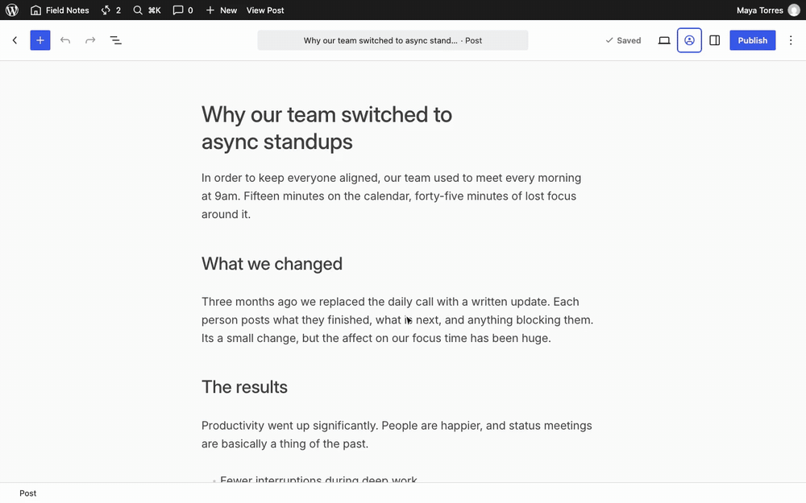
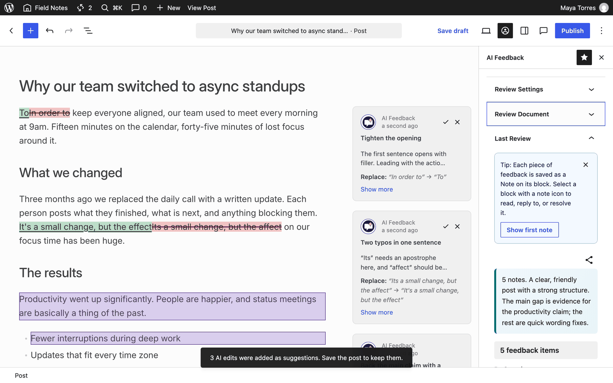
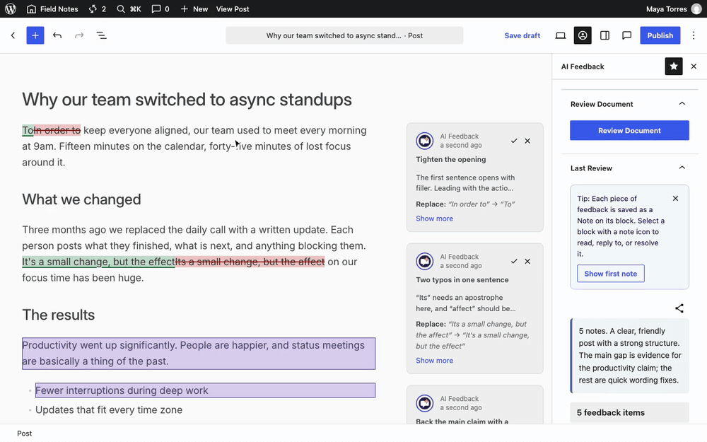
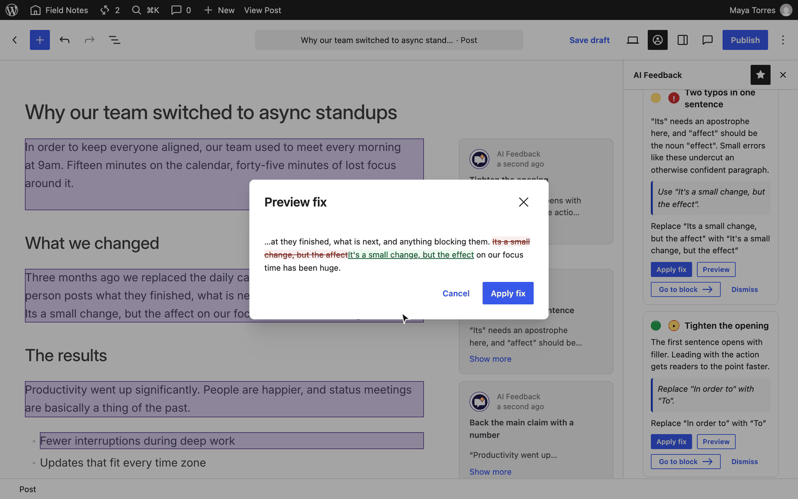
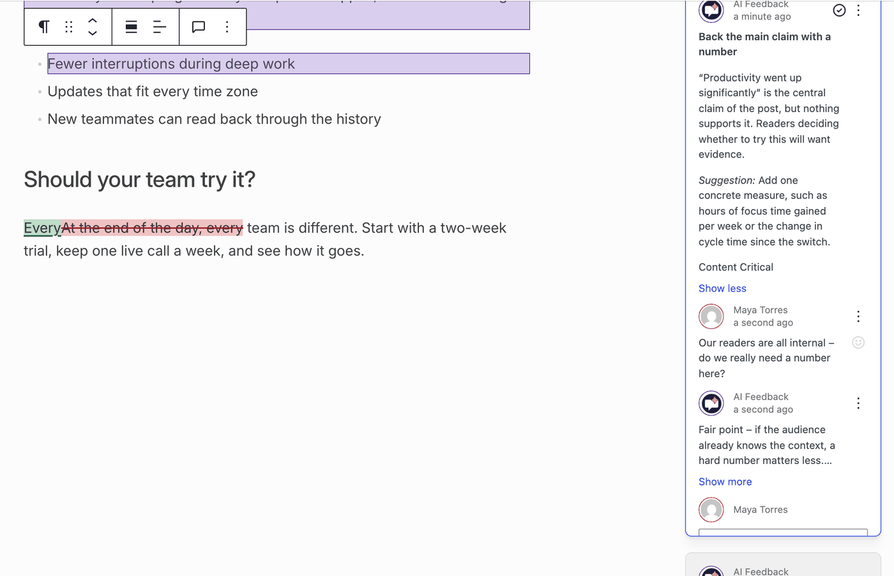
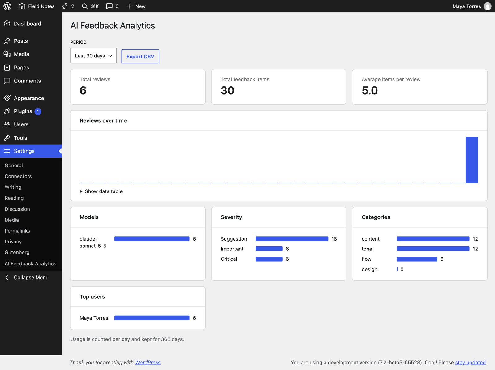

# Fresh Eyes: AI Editorial Feedback

A fresh pair of eyes on your draft, right in the block editor. (Formerly Copydesk AI and AI Feedback.)

AI-powered editorial feedback for WordPress Gutenberg, built on WordPress 7.0's core AI Client, Connectors API, and Notes feature.

[](https://playground.wordpress.net/?blueprint-url=https://raw.githubusercontent.com/adamsilverstein/fresh-eyes/main/docs/playground/blueprint.json)

The button opens a sample draft in [WordPress Playground](https://wordpress.org/playground/) with the latest Fresh Eyes release and Gutenberg's Suggestion Mode experiment switched on, so suggested edits work right away. Add an API key for Anthropic, OpenAI or Google under **Settings → Connectors**, then open the Fresh Eyes sidebar and run a review. The setup lives in [`docs/playground/blueprint.json`](docs/playground/blueprint.json).

## Overview

The AI Feedback plugin integrates AI-powered content review directly into the WordPress block editor. It uses the WordPress 7.0 core [AI Client](https://make.wordpress.org/core/2026/03/24/introducing-the-ai-client-in-wordpress-7-0/) for provider-agnostic AI access, the [Connectors API](https://make.wordpress.org/core/2026/03/18/introducing-the-connectors-api-in-wordpress-7-0/) for credentials, and the native Notes API for contextual, block-level feedback.



## Features

- 🤖 **AI-Powered Reviews**: Get intelligent feedback on content quality, tone, flow, design, and grammar and spelling
- 📝 **Native Notes Integration**: Feedback appears as WordPress block comments
- 🔌 **Core Connectors API**: Reuses the credentials configured in Settings → Connectors
- 🔄 **Multiple AI Providers**: Works with Anthropic, OpenAI, Google, and any other provider registered with the core AI Client
- 💬 **Conversational Feedback**: Reply to AI feedback and get clarifications
- 🙋 **Ask Fresh Eyes**: Type `@fresh-eyes` in any note to ask about the selected text or blocks, and get suggested changes to accept
- ✏️ **Suggested Edits**: Simple fixes arrive as tracked suggestions you accept or reject (with Gutenberg's Suggestion Mode experiment)
- 🎯 **Focus Areas**: Content Quality, Tone & Voice, Flow & Structure, Design & Formatting

## Requirements

- **WordPress**: 7.0 or higher
- **PHP**: 8.1 or higher
- **AI Provider**: At least one provider configured under Settings → Connectors
- **Node.js**: 22.0 or higher (for development)
- **npm**: 9.0 or higher (for development)

## Installation

### Prerequisites

WordPress 7.0 ships the AI Client and Connectors API in core, so AI Feedback no longer needs the standalone AI Experiments plugin or a separate Composer-installed AI SDK.

Before using AI Feedback, configure an AI provider:
1. Go to WordPress Admin → **Settings → Connectors**.
2. Choose a provider (Anthropic, OpenAI, Google, etc.) and install its provider plugin if prompted.
3. Provide an API key directly, or set the corresponding environment variable / PHP constant (e.g. `ANTHROPIC_API_KEY`). Environment variables and PHP constants take precedence over database-stored values.
4. Save.

### 1. Clone the Repository

```bash
git clone https://github.com/adamsilverstein/fresh-eyes.git
cd fresh-eyes
```

### 2. Install Dependencies

```bash
# Install PHP dependencies
composer install

# Install JavaScript dependencies
npm install
```

### 3. Build Assets

```bash
# Production build
npm run build

# Development build with watch
npm run start
```

### 4. Set Up Local Environment (Optional)

```bash
# Start WordPress environment
npm run env:start

# The site will be available at http://localhost:8889
# Login: admin / password
```

### 5. Activate the Plugin

If using wp-env, the plugin is automatically activated. Otherwise:

1. Copy the plugin folder to `wp-content/plugins/ai-feedback`
2. Go to WordPress Admin → Plugins
3. Activate "AI Feedback"

## Configuration

### AI Provider Setup

The plugin calls WordPress 7.0's `wp_ai_client_prompt()` directly, so credentials are managed by the core [Connectors API](https://make.wordpress.org/core/2026/03/18/introducing-the-connectors-api-in-wordpress-7-0/).

**Option 1: Settings → Connectors (recommended)**

1. Go to **Settings → Connectors** in WordPress admin.
2. Pick a provider (Anthropic, OpenAI, Google, etc.).
3. Enter the API key.
4. Save.

**Option 2: Environment variables or PHP constants**

The Connectors API checks for credentials in this order:
1. Environment variable (e.g. `ANTHROPIC_API_KEY`)
2. PHP constant (defined via `define()`)
3. Database setting saved via the Connectors screen

```php
// In wp-config.php - these take precedence over the database value.
define( 'ANTHROPIC_API_KEY', 'your-api-key-here' );
define( 'OPENAI_API_KEY',    'your-api-key-here' );
define( 'GOOGLE_API_KEY',    'your-api-key-here' );
```

### Default Settings

The plugin sets these defaults on activation:

- **Default Model**: Claude Sonnet 5.5
- **Focus Areas**: Content, Tone, Flow
- **Target Tone**: Professional

You can change these in the plugin sidebar within the block editor.

## Usage

### Basic Review

1. Open a post in the block editor
2. Click the **AI Feedback** icon in the toolbar (or open from "Options" menu)
3. Adjust settings if needed under **Review Settings**, which starts collapsed once the post has a review:
   - Select AI model
   - Choose focus areas
   - Set target tone
4. Click **Review Document**
5. AI will analyze your content and attach notes to relevant blocks

### Keyboard Shortcuts

The shortcuts use the editor's "access" modifier: <kbd>Shift</kbd>+<kbd>Alt</kbd> on Windows and Linux, <kbd>Ctrl</kbd>+<kbd>Option</kbd> on a Mac. They are also listed in the editor's Keyboard shortcuts help (Access + H).

| Shortcut | Action |
|----------|--------|
| Access + R | Open the sidebar and review the document |
| Access + F | Show or hide the AI Feedback sidebar |
| Access + J | Go to the next block with AI feedback |
| Access + K | Go to the previous block with AI feedback |

### Working with Notes

- 📝 Notes appear as indicators on blocks with feedback
- Click a note indicator to read the feedback
- Each note includes:
  - **Title**: Brief summary
  - **Feedback**: Detailed explanation
  - **Suggestion**: Actionable recommendation (if applicable)
  - **Severity**: 🟢 Suggestion, 🟡 Important, 🔴 Critical



### Suggested Edits

When the AI proposes a simple wording change, such as fixing a typo or cutting filler words, the note carries the exact edit.

**With Gutenberg's Suggestion Mode experiment** (Gutenberg plugin → Experiments → Collaboration → Suggestion Mode), the edit is added to the text as a tracked suggestion. Accept or reject each one from its note, then save the post to keep the result.



**Without Suggestion Mode**, the same edit is offered as a quick fix in the sidebar. **Preview** shows the change before **Apply fix** makes it.



### Reply to Feedback

1. Click on a note to open it
2. Type a reply, for example to push back or ask for clarification
3. The AI answers in the same thread, using the block's content and the conversation so far



### Ask Fresh Eyes in a Note

1. Select text or blocks and add a note, or reply in any note thread
2. Type `@fresh-eyes` and a request, for example "@fresh-eyes simplify this" or "@fresh-eyes adjust the tone"
3. Fresh Eyes answers in the thread. A change it suggests is offered for you to accept, in the **Ask Fresh Eyes** panel or as a suggestion with Suggestion Mode on

Fresh Eyes can't search the web, so it declines requests to research or link to sources. The name doesn't autocomplete in the Notes `@` menu, since Fresh Eyes isn't a site user; type it out.

### Usage Analytics

**Settings → AI Feedback Analytics** shows how many reviews were run, by which model and user, and how the feedback breaks down by severity and category.



## Development

### Project Structure

```
fresh-eyes/
├── fresh-eyes.php           # Main plugin file
├── includes/                  # PHP classes
│   ├── class-plugin.php      # Bootstrap
│   ├── class-settings-controller.php
│   └── ...
├── src/                       # JavaScript/React source
│   ├── index.js              # Entry point
│   ├── store/                # WordPress data store
│   ├── components/           # React components
│   └── index.scss            # Styles
├── build/                     # Compiled assets (gitignored)
├── tests/                     # Test files
└── docs/                      # Documentation
```

### Available Scripts

```bash
# Development
npm run start              # Watch mode with hot reload
npm run build              # Production build
npm run format             # Format code with Prettier

# Linting
npm run lint:js            # ESLint
npm run lint:css           # Stylelint
npm run lint:pkg-json      # Package.json validation
npm run lint:php           # PHPCS + PHPStan

# Testing
npm run test:unit          # JavaScript unit tests
npm run test:php           # PHP unit tests
composer test              # PHP unit tests (alternative)
npm run test:e2e           # End-to-end tests
npm run test:all           # Run JS linting and tests

# WordPress Environment
npm run env:start          # Start wp-env
npm run env:stop           # Stop wp-env
npm run env:clean          # Clean wp-env

# Build
npm run plugin-zip         # Create release zip
```

### Running Tests

```bash
# JavaScript tests (Vitest)
npm run test:unit

# PHP tests (PHPUnit)
composer test

# E2E tests (Playwright)
npm run test:e2e

# Run all tests
npm run test:all
```

### Code Standards

The plugin follows:
- **PHP**: WordPress Coding Standards
- **JavaScript**: WordPress ESLint configuration
- **CSS**: WordPress Stylelint configuration

### Continuous Integration

All pull requests automatically run through GitHub Actions CI/CD:
- ✅ JavaScript linting (ESLint, Stylelint, Prettier)
- ✅ PHP linting (PHPCS, PHPStan)
- ✅ JavaScript unit tests (Vitest)
- ✅ PHP unit tests (PHPUnit) on PHP 8.1 and 8.5

See [docs/CI.md](docs/CI.md) for details on running checks locally and setting up branch protection.

## Architecture

### PHP Backend

- **Settings Controller**: REST API for settings management
- **Review Service**: Orchestrates document analysis (Phase 2)
- **Reply Service**: Answers replies to AI notes, right away in the editor with WP-Cron as the fallback
- **Notes Manager**: Creates and manages Notes (Phase 3)
- **Prompt Builder**: Constructs AI prompts (Phase 2)

### JavaScript Frontend

- **WordPress Data Store**: State management with `@wordpress/data`
- **React Components**: UI built with WordPress components
- **REST API Integration**: Communicates with PHP backend

### Data Flow

```
Editor → Plugin Sidebar → Data Store → REST API → PHP Services → AI Client → AI Provider
                                                                              ↓
Editor ← Notes API ← Notes Manager ← Response Parser ← AI Client ← AI Response
```

## Project Status

**Current release:** 1.0.3. Phases 1 to 4 are complete. Phase 5 shipped 1.0.0, with streaming and the Abilities API still to come.

### Phase 1: Foundation ✅ Complete
- Plugin scaffold with build system
- Plugin sidebar UI with settings
- Model selector with provider grouping
- Focus areas and tone selection
- Settings REST API with caching
- WordPress data store (selectors, actions, reducer)
- Review button with loading states

### Phase 2: AI Integration & Review ✅ Complete
- [x] Review Service with block parsing
- [x] Prompt engineering for different focus areas
- [x] AI response parsing and validation
- [x] Review REST endpoint
- [x] Error handling and rate limiting

### Phase 3: Notes Integration ✅ Complete
- [x] Notes Manager for WordPress Notes API
- [x] Block-level note indicators
- [x] Note resolution tracking
- [x] Review history display

### Phase 4: Conversation Loop ✅ Complete
Tracked in issues [#131](https://github.com/adamsilverstein/fresh-eyes/issues/131)-[#134](https://github.com/adamsilverstein/fresh-eyes/issues/134).
- [x] Reply detection hook ([#131](https://github.com/adamsilverstein/fresh-eyes/issues/131))
- [x] Context-aware reply prompts / Reply Service ([#132](https://github.com/adamsilverstein/fresh-eyes/issues/132))
- [x] Async reply processing ([#133](https://github.com/adamsilverstein/fresh-eyes/issues/133))
- [x] Conversation threading UI ([#134](https://github.com/adamsilverstein/fresh-eyes/issues/134))

### Phase 5: Polish & Release 🚧 In progress
- [x] Accessibility: skip links, visible focus indicators, WCAG AA color contrast, ARIA live regions, descriptive screen reader labels
- [x] Onboarding: first-run welcome modal, empty state guidance
- [x] AI quality: few-shot examples, block-type specific instructions, multi-language support, deduplication
- [x] Health check REST endpoint
- [x] E2E infrastructure with Playwright
- [x] Quick fixes, suggested edits, review history, export and usage analytics
- [x] Release v1.0.0
- [ ] Abilities API integration
- [ ] Streaming responses ([#60](https://github.com/adamsilverstein/fresh-eyes/issues/60))

## API Documentation

See [docs/API.md](docs/API.md) for complete REST API documentation.

## Testing Documentation

See [docs/TESTING.md](docs/TESTING.md) for comprehensive testing guide.

## Contributing

Contributions are welcome! Please:

1. Fork the repository
2. Create a feature branch (`git checkout -b feature/amazing-feature`)
3. Commit your changes (`git commit -m 'Add amazing feature'`)
4. Push to the branch (`git push origin feature/amazing-feature`)
5. Open a Pull Request

### Development Guidelines

- Follow WordPress coding standards
- Write tests for new features
- Update documentation as needed
- Ensure all tests pass before submitting PR

## License

GPL v2 or later

## Credits

- Built on the WordPress 7.0 core [AI Client](https://make.wordpress.org/core/2026/03/24/introducing-the-ai-client-in-wordpress-7-0/) and [Connectors API](https://make.wordpress.org/core/2026/03/18/introducing-the-connectors-api-in-wordpress-7-0/)
- Uses the WordPress Notes API for block-level comments
- Powered by AI providers: Anthropic, OpenAI, Google (any provider registered with the core AI Client)

## Support

- **Issues**: [GitHub Issues](https://github.com/adamsilverstein/fresh-eyes/issues)
- **Documentation**: [docs/](docs/)
- **WordPress**: Requires 7.0+

## Changelog

See the changelog in [readme.txt](readme.txt) for release notes.

### Coming Soon
- Streaming responses once the core AI Client supports them ([#60](https://github.com/adamsilverstein/fresh-eyes/issues/60))
- Abilities API integration

---

Built with ❤️ for WordPress
