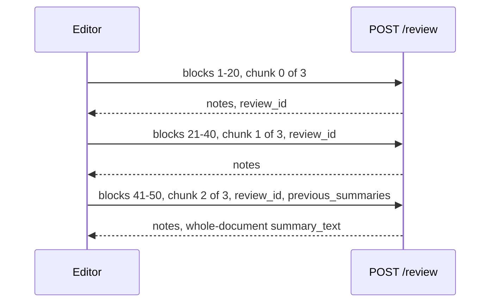

# API Reference

This document provides complete API documentation for the AI Feedback plugin.

## REST API

Base URL: `/wp-json/ai-feedback/v1/`

All endpoints require authentication via WordPress cookies or application passwords.

---

### POST /review

Initiates an AI review of a document.

#### Request

```http
POST /wp-json/ai-feedback/v1/review
Content-Type: application/json
X-WP-Nonce: {nonce}
```

**Body Parameters:**

| Parameter | Type | Required | Description |
|-----------|------|----------|-------------|
| `post_id` | integer | Yes | The post ID to review |
| `blocks` | array | Yes | Blocks to review. Each item has `clientId`, `name`, `content`, an optional `anchor`, for an inner block its parent's `clientId` as `parent`, and for headings, lists and images the `attributes` formatting fixes check: `level`, `ordered`, or an image's `alt`, attachment `id` and `url`. Images are sent even without a caption, with `content` empty |
| `model` | string | No | AI model to use (default: site default) |
| `focus_areas` | array | No | Areas to focus on: `content`, `tone`, `flow`, `design` |
| `target_tone` | string | No | Target tone: `professional`, `casual`, `academic`, `friendly` |
| `chunk_index` | integer | No | Zero-based part number when a large document is reviewed in parts (default: `0`) |
| `chunk_total` | integer | No | Number of parts in the review (default: `1`) |
| `review_id` | string | No | Review ID returned for part 0, required for later parts |
| `previous_summaries` | array | No | Summary text of earlier parts, sent with the last part |

**Block anchors:**

Each block may carry an `anchor`: a hash of its block name and text content, matching `^[a-z0-9]{1,32}$`. The editor computes it with `getBlockAnchor()` in `src/utils/block-utils.js`. It is stored on the block's note as `block_anchor` meta, so the editor can re-link the note to its block after a reload, when the block's `clientId` has changed and its `metadata.noteId` was never saved. Malformed anchors fail validation; missing ones store no anchor.

**Chunked reviews:**

Documents with more blocks than the chunk size (`chunk_size` from `GET /settings`, default 20) are reviewed in several requests, each holding at most `chunk_size` blocks. The editor does this automatically:

1. Part 0 is checked against the rate limit and returns a `review_id`.
2. Later parts send that `review_id` and must arrive in order. They do not count against the rate limit.
3. The last part sends `previous_summaries`, so its `summary_text` covers the whole document.

Each response includes `chunk: { index, total }`. Each later part is claimed under a lock before the AI call, so a replayed or concurrent request for the same part returns `409 review_chunk_in_progress`, and a part that does not match the active review returns `409 invalid_review_chunk`. A failed part can be retried, up to two failures per review.



**Structural edits:**

A note can carry a `block_action`: a change to the document's structure the author can accept or reject, instead of a `quick_fix`. It is stored as JSON in the note's `feedback_block_action` comment meta and returned on each note (null when there is none):

| Type | Fields | Description |
|------|--------|-------------|
| `remove_block` | | Remove the note's block |
| `move_block` | `position`, `target_block_id`, `target_name`, `target_text` | Move the note's block `before` or `after` another reviewed block. The target is kept by client ID, block name and the first 80 characters of its text, so the editor can find it again after a reload |
| `insert_block` | `position`, `block` | Add a block `before` or `after` the note's block. `block` is `{ "name": "core/paragraph", "content" }`, `{ "name": "core/heading", "content", "level" }` (2-6) or `{ "name": "core/list", "items", "ordered" }` (up to 20 items) |

The AI writes them as `{ "type": "remove" }`, `{ "type": "move", "target_block_id", "position" }` and `{ "type": "insert", "position", "block" }`. `Response_Parser` drops any that fail validation and keeps the note: the target must be one of the blocks in the same request (so a chunked review only moves within its part), a block can't move next to itself, next to one of its own inner blocks (found through `parent`), or to where it already is, a review gets at most one per block, inserted blocks must be on the allow-list (`ai_feedback_insertable_blocks`), and inserted text may only hold inline formatting and goes through `wp_kses()`. Groups of similar notes have none.

The editor shows each one on its note with a one-line description, such as "Move above “Why this matters”" or "Remove this block and the 2 blocks inside it". Apply is a single undo step. An edit whose block or move target is gone shows as outdated, a move next to one of the block's own inner blocks is never offered, and a removal that would take a block linked to another note with it is not offered.

With Gutenberg's Suggestion Mode on, a review note's removal, or a move that stays within one parent block, becomes a pending structural suggestion (Gutenberg's apply-and-tag shape: a `metadata.suggestion` marker carrying the note ID, plus a `block-remove` or `block-move` operation on the note). This needs Gutenberg's structural suggestions, detected by `gutenberg_strip_pending_structural_suggestions()` and filterable through `ai_feedback_use_structural_suggestions`. The stored payload is read back after it is saved, and if it is not what was sent the note goes back to a plain note. Inserts, moves between parent blocks, and structural edits from replies stay with Preview and Apply in the sidebar.

Known limitation: the plugin can't tell whether the editor is in Gutenberg's Edit or Suggest intent. Gutenberg only exposes that through a private selector (`getEditorIntent()`) and nothing in the page reflects it. In Suggest intent, Gutenberg's own capture may record a suggested move a second time, as a pending move by the current user. Run reviews in Edit intent when Suggestion Mode is on.

**Formatting fixes:**

A note can carry a `block_change`: a one-click formatting fix that never adds, drops or rewrites the block's words. It is stored as JSON in the note's `feedback_block_change` comment meta (`Notes_Manager::BLOCK_CHANGE_META_KEY`) and returned on each note (null when there is none):

| Type | Fields | Description |
|------|--------|-------------|
| `set_attributes` | `attributes`, `from`, and `image` for alt text or a caption | Set allow-listed attributes: a heading's `level` (2-6), a list's `ordered`, an image's `alt` and `caption`. `from` holds the values the AI saw, and `image` the URL of the image it described |
| `transform` | `to`, and `items` and `ordered` for a list, or `text` (and `level` for a heading) | Turn a paragraph into a `core/list` or `core/heading`, or a heading into a `core/paragraph`. `text` is the block's reviewed text, at most 200 characters |
| `split` | `after`, `next`, `next_length` | Split a paragraph after this sentence ending; `next` is the start of the text after it and `next_length` its length in characters |

`Block_Change::validate()` drops any that fail validation and keeps the note: every attribute must be on its block type's allow-list and differ from the current value; a list's items must appear in the paragraph in order with only separators (commas, semicolons, a final "and" or "or") between them, and text before the first item stays as an introduction unless it ends in a comma or semicolon (which would mean items were left out); a split must fall after sentence-ending punctuation that appears once, with text after it. A review gets one change per block, shared with `block_action`, which wins on the same item; either replaces the `quick_fix` of every item on that block, once grouping has kept it. Groups of similar notes have none, and only a thread's root note keeps one. `Block_Change::decode()` checks the allow-lists again when the meta is read.

Alt text and captions are only proposed for an image the AI was shown, and only where the image has none. When the selected model has the `vision` capability in the model list, `Review_Images` attaches up to four images (`ai_feedback_max_review_images`) from image blocks without alt text, as inline base64 data through the core AI client's `with_file()`. Only Media Library images are sent: the block must have an attachment ID whose URL (scheme, host, port and file) matches its own, the current user must be able to read the attachment, and the file is read from the uploads directory (a `medium_large`, `large` or `medium` size first), at most 1.5 MB, JPEG, PNG, GIF or WebP. External images are never fetched, so the AI only flags their missing alt text, as it does for every image with a text-only model. Images also stop once their total passes 3 MB. Images served from a CDN or offloaded media host, or a block still showing an image's file from before it was edited in the Media Library (`-e{timestamp}`), don't match their attachment's URL and are skipped. If the model refuses the request with images, the review runs again on the text alone. Note that this sends the post's images to the AI provider, as reviews already send its text; return 0 from `ai_feedback_max_review_images` to keep images on the site. Proposed alt text is treated as untrusted plain text: markup drops it, and it is capped at 250 characters. An image can hold text written to steer the model; the prompt tells it to treat such text as part of the image, and the strict validation plus Preview before Apply means nothing reaches the post without the author choosing it. With `WP_DEBUG` on, `Logger::debug()` notes each image block that was not sent and why.

The editor shows each one on its note with a one-line description, such as "Change to a level 3 heading", "Turn into a list" or "Split the paragraph after “…”", with Preview (before and after) and Apply fix. Everything is checked again against the live block: a change whose block changed since the review (another level, image, text or list type) reads as outdated, a transform is only offered when the editor offers it (`getBlockTransformItems()`), and a list split that would drop an inline object is not offered. Text is sliced from the block's rich text, so links and formatting stay, and the note's link (`metadata`) moves to the new list, heading or first half of a split. Apply is one undo step and is only marked applied if the block now reads as the change leaves it. A paragraph's anchor moves to the list's introduction, or the list. The introduction keeps the paragraph's styling, and the list gets what core's own transforms carry over (class name, font size and colors, where the list supports them). A split's second half keeps the paragraph's styling but not its drop cap. Formatting fixes stay with Preview and Apply when Gutenberg's Suggestion Mode is on. A formatting fix is also the thread's first suggested edit: the reply prompt gets it as the pending edit until the saved post shows it, the first reply edit after it is revision 2, and the note gets quick replies ("Try another" and "Why?").

**Example Request:**

```json
{
  "post_id": 123,
  "model": "claude-sonnet-5-5",
  "focus_areas": ["content", "tone", "flow"],
  "target_tone": "professional"
}
```

#### Response

**Success (200 OK):**

```json
{
  "review_id": "550e8400-e29b-41d4-a716-446655440000",
  "notes": [
    {
      "id": 456,
      "block_id": "abc123-def456",
      "block_index": 2,
      "category": "content",
      "severity": "suggestion",
      "priority": 60,
      "title": "Consider adding context",
      "content": "The opening paragraph jumps directly into technical details. Adding a sentence about why this matters could help readers understand the significance.",
      "suggestion": "Start with the problem this solves before explaining the solution."
    },
    {
      "id": 457,
      "block_id": "ghi789-jkl012",
      "block_index": 5,
      "category": "tone",
      "severity": "important",
      "priority": 70,
      "title": "Inconsistent tone",
      "content": "This section shifts to a very casual tone ('super easy', 'just do this') which contrasts with the professional tone used elsewhere.",
      "suggestion": null
    }
  ],
  "summary": {
    "total_notes": 5,
    "by_category": {
      "content": 2,
      "tone": 1,
      "flow": 2,
      "design": 0
    },
    "by_severity": {
      "suggestion": 3,
      "important": 2,
      "critical": 0
    }
  },
  "model_used": "claude-sonnet-5-5",
  "tokens_used": 1523,
  "created_at": "2025-12-06T14:30:00Z"
}
```

**Error Responses:**

| Status | Error Code | Description |
|--------|------------|-------------|
| 400 | `invalid_post_id` | Post ID is missing or invalid |
| 403 | `forbidden` | User cannot edit this post |
| 404 | `post_not_found` | Post does not exist |
| 429 | `rate_limit_exceeded` | Too many review requests |
| 500 | `ai_error` | AI provider returned an error |
| 503 | `ai_service_unavailable` | AI provider is temporarily unavailable (network error, provider outage or rate limit). `data.retry_after` gives the suggested wait in seconds. The review does not count against the hourly rate limit. |

```json
{
  "code": "forbidden",
  "message": "You do not have permission to review this post.",
  "data": {
    "status": 403
  }
}
```

---

### POST /reply

Submit a reply to an AI feedback note and receive an AI response.

#### Request

```http
POST /wp-json/ai-feedback/v1/reply
Content-Type: application/json
X-WP-Nonce: {nonce}
```

**Body Parameters:**

| Parameter | Type | Required | Description |
|-----------|------|----------|-------------|
| `note_id` | integer | Yes | The note (comment) ID to reply to |
| `reply_content` | string | Yes | The user's reply text |

**Example Request:**

```json
{
  "note_id": 456,
  "reply_content": "I want to keep this informal because my target audience is hobbyist developers."
}
```

#### Response

**Success (200 OK):**

```json
{
  "reply_id": 789,
  "content": "That context is helpful! For hobbyist developers, the informal tone works well. You might consider adding a brief note at the beginning indicating this is a casual tutorial - that sets expectations and prevents confusion for readers who stumble upon this from a search engine.",
  "updated_suggestion": "Add a one-line intro like 'This is a quick, no-frills guide for hobby projects.'",
  "created_at": "2025-12-06T14:35:00Z"
}
```

**Error Responses:**

| Status | Error Code | Description |
|--------|------------|-------------|
| 400 | `invalid_note_id` | Note ID is missing or invalid |
| 400 | `empty_reply` | Reply content is empty |
| 403 | `forbidden` | User cannot reply to this note |
| 404 | `note_not_found` | Note does not exist |
| 410 | `note_resolved` | Note has already been resolved |

---

### GET /replies

List the replies under every AI Feedback note in a post, oldest first, in one request. The sidebar uses this to show each conversation.

#### Request

```http
GET /wp-json/ai-feedback/v1/replies?post={post_id}
X-WP-Nonce: {nonce}
```

The current user must be able to edit the post.

#### Response

```json
{
  "post": 123,
  "threads": {
    "456": {
      "replies": [
        { "id": 789, "author": "Jane", "content": "Make that change.", "is_ai": false, "date": "2026-11-19 10:00:00", "edit": null, "revision": null },
        {
          "id": 790,
          "author": "Fresh Eyes",
          "content": "Done: \"last year\" now reads \"in 2025\".",
          "is_ai": true,
          "date": "2026-11-19 10:00:05",
          "edit": { "type": "replace_text", "find": "last year", "replace": "in 2025" },
          "revision": 1
        }
      ],
      "pending_reply_id": null
    }
  }
}
```

`threads` is keyed by the AI note's ID. `content` is plain text. `pending_reply_id` is the newest user reply still waiting on the AI, or null.

`edit` is the change an AI reply proposes for the note's block, or null. The AI only proposes one when the user's reply asks for a change. It is one of:

| Type | Fields | Description |
|------|--------|-------------|
| `replace_text` | `find`, `replace` | Plain text find and replace. `find` appears exactly once in the block, as with a review's `quick_fix` |
| `rewrite_block` | `content`, `original` | New text for the whole block, with inline formatting only (`a`, `b`, `br`, `code`, `em`, `i`, `s`, `strong`, `sub`, `sup`). `original` is the block text the AI saw, so the editor can tell once the edit is outdated. Only for blocks with a rich text `content` attribute whose text has no links, formatting or line breaks, since the AI only sees plain text and a rewrite would drop them |

| `remove_block`, `move_block`, `insert_block` | See [structural edits](#post-review) | A structural edit. The reply prompt lists up to five blocks on each side of the note's block, at the same level, as `b1`, `b2` and so on, and the note's block as `this`; a move names its target by that reference. The server has no client IDs, so `target_block_id` is empty and the editor finds the target by name and text |

Invalid edits are dropped on the server and the reply posts without one. A `replace_text` edit needs a `replace` string; an empty one deletes `find`. A reply with a valid edit but no text reads "Here is that change.", and a reply whose JSON can't be read at all fails, so it can be retried, rather than posting the raw JSON. The edit is stored as JSON in the reply's `feedback_reply_edit` comment meta. The editor never applies it on its own: with Gutenberg's Suggestion Mode on it becomes a pending suggestion on the AI reply, otherwise the sidebar offers Preview and Apply.

`revision` numbers the suggested edits in a thread, oldest first, or is null for a reply without an edit. The review's `quick_fix`, `block_action` or `block_change` on the note counts as the first, so the first reply edit after one is revision 2. It is stored in the reply's `feedback_revision` comment meta, and the Notes UI shows it as a "Suggested edit" or "Revised suggestion (2)" badge.

Only the newest edit in a thread can be acted on. A new edit supersedes the earlier ones: the editor shows them as replaced, and with Suggestion Mode on it takes their markers out of the block and marks them `rejected-unsaved`, which Gutenberg finalizes as `rejected` when the post is saved (its status list has no `superseded`). When the author replies to a thread whose newest edit is still pending, the reply prompt includes that edit, so the AI can revise it. The block text in the prompt reads as it does with any pending suggestion rejected.

---

### GET /replies/{id}/status

Poll the state of an AI reply. When a user replies to an AI Feedback note, the plugin marks the reply `pending` and schedules a single `ai_feedback_generate_reply` WP-Cron event. The editor then answers the reply right away through [`POST /replies/{id}/process`](#post-repliesidprocess), and the cron event is the fallback for replies posted outside the editor. Whichever runs first generates the AI response, saves it as a child note, and records the result on the user's reply.

#### Request

```http
GET /wp-json/ai-feedback/v1/replies/{id}/status
X-WP-Nonce: {nonce}
```

`{id}` is the user's reply comment ID. The current user must be able to edit the post the reply belongs to.

#### Response

**Success (200 OK):**

```json
{
  "reply_id": 789,
  "status": "complete",
  "ai_reply_comment_id": 790
}
```

| Field | Type | Description |
|-------|------|-------------|
| `reply_id` | integer | The user's reply comment ID |
| `status` | string | `pending`, `complete`, `failed`, or `unknown` (no reply was scheduled for this comment) |
| `ai_reply_comment_id` | integer | The generated AI reply note. Present when `complete` |
| `error` | string | Why generation failed. Present when `failed` |
| `retry_after` | integer | Seconds until a retry will run. Present when `failed` and the last attempt was under 10 seconds ago |

The response field is `ai_reply_comment_id`, while the comment meta that stores it is `ai_feedback_reply_comment_id`.

**Errors:**

| Status | Code | Description |
|--------|------|-------------|
| 403 | `rest_forbidden` | User cannot edit the reply's post |
| 404 | `rest_comment_invalid_id` | No comment with that ID |

> **Note:** Replies posted in the block editor do not wait on WP-Cron. A reply posted elsewhere, such as over the REST API, is answered when WP-Cron runs. On a site where WP-Cron does not run, it is answered the next time someone opens the post in the editor, and reads as `failed` once it has been pending for 10 minutes until then.

---

### POST /replies/{id}/process

Generate the AI answer to a pending reply within this request, so the answer does not depend on WP-Cron. The editor calls this as soon as it sees a pending reply.

Each reply is answered once. The request claims the reply by moving its status from `pending` to `processing` with a compare-and-set update, so when this endpoint and the cron event race, only one of them generates an answer. A reply that is already answered or being answered is left alone.

#### Request

```http
POST /wp-json/ai-feedback/v1/replies/{id}/process
X-WP-Nonce: {nonce}
Content-Type: application/json

{ "retry": false }
```

| Parameter | Type | Description |
|-----------|------|-------------|
| `retry` | boolean | Also answer a `failed` reply, or take over a claim older than 90 seconds from a request that died. Default `false` |

A retry within 10 seconds of the last attempt is ignored, since each attempt is a paid AI request. The response then stays `failed` and `retry_after` says how long to wait.

Same permission rules as `GET /replies/{id}/status`.

#### Response

The reply status, in the same shape as `GET /replies/{id}/status`. A reply that is still being answered by another request reports `pending`.

---

### GET /settings

Retrieve current AI Feedback settings.

#### Request

```http
GET /wp-json/ai-feedback/v1/settings
X-WP-Nonce: {nonce}
```

#### Response

**Success (200 OK):**

```json
{
  "default_model": "claude-sonnet-5-5",
  "default_focus_areas": ["content", "tone", "flow"],
  "default_tone": "professional",
  "available_models": [
    {
      "id": "claude-sonnet-5-5",
      "name": "Claude Sonnet 5.5",
      "provider": "anthropic",
      "capabilities": ["text"],
      "max_tokens": 200000
    },
    {
      "id": "claude-opus-4",
      "name": "Claude Opus 4",
      "provider": "anthropic",
      "capabilities": ["text"],
      "max_tokens": 200000
    },
    {
      "id": "gpt-4o",
      "name": "GPT-4o",
      "provider": "openai",
      "capabilities": ["text", "vision"],
      "max_tokens": 128000
    },
    {
      "id": "gemini-2.5-flash",
      "name": "Gemini 2.5 Flash",
      "provider": "google",
      "capabilities": ["text"],
      "max_tokens": 1000000
    }
  ],
  "available_focus_areas": [
    {
      "id": "content",
      "label": "Content Quality",
      "description": "Clarity, accuracy, and completeness"
    },
    {
      "id": "tone",
      "label": "Tone & Voice",
      "description": "Consistency and audience appropriateness"
    },
    {
      "id": "flow",
      "label": "Flow & Structure",
      "description": "Logical progression and transitions"
    },
    {
      "id": "design",
      "label": "Design & Formatting",
      "description": "Block usage and visual hierarchy"
    }
  ],
  "available_tones": [
    { "id": "professional", "label": "Professional" },
    { "id": "casual", "label": "Casual" },
    { "id": "academic", "label": "Academic" },
    { "id": "friendly", "label": "Friendly" }
  ]
}
```

---

### POST /settings

Save the current user's review preferences. Each user has their own model, focus areas, tone and language, stored in user meta. Requires `edit_posts`.

Send `scope: "site"` to change the site defaults instead, which apply to users who have not picked a value. This requires `manage_options`.

`GET /settings` returns the user's own value for each setting, falling back to the site default and then the plugin default.

#### Request

```http
POST /wp-json/ai-feedback/v1/settings
Content-Type: application/json
X-WP-Nonce: {nonce}
```

**Body Parameters:**

| Parameter | Type | Required | Description |
|-----------|------|----------|-------------|
| `scope` | string | No | `user` (default) saves the current user's preferences. `site` saves the site defaults and requires `manage_options` |
| `default_model` | string | No | Default AI model ID |
| `default_focus_areas` | array | No | Default focus areas |
| `default_tone` | string | No | Default target tone |
| `feedback_locale` | string | No | Feedback language, or `auto` |

**Example Request:**

```json
{
  "default_model": "gpt-4o",
  "default_focus_areas": ["content", "design"],
  "default_tone": "casual"
}
```

#### Response

**Success (200 OK):**

Returns the updated settings object (same format as GET /settings).

**Error Responses:**

| Status | Error Code | Description |
|--------|------------|-------------|
| 400 | `invalid_model` | Model ID is not valid |
| 400 | `invalid_focus_area` | Focus area is not valid |
| 400 | `invalid_tone` | Tone is not valid |
| 403 | `rest_forbidden` | User cannot edit posts, or sent `scope: "site"` without `manage_options` |

---

### GET /reviews

List review history for a post.

#### Request

```http
GET /wp-json/ai-feedback/v1/reviews?post_id=123
X-WP-Nonce: {nonce}
```

**Query Parameters:**

| Parameter | Type | Required | Description |
|-----------|------|----------|-------------|
| `post_id` | integer | Yes | The post ID |
| `per_page` | integer | No | Results per page (default: 10, max: 100) |
| `page` | integer | No | Page number (default: 1) |

#### Response

**Success (200 OK):**

```json
{
  "reviews": [
    {
      "review_id": "550e8400-e29b-41d4-a716-446655440000",
      "created_at": "2025-12-06T14:30:00Z",
      "model_used": "claude-sonnet-5-5",
      "focus_areas": ["content", "tone", "flow"],
      "summary": {
        "total_notes": 5,
        "resolved_notes": 3
      }
    },
    {
      "review_id": "660f9500-f3ac-52e5-b827-557766551111",
      "created_at": "2025-12-05T10:15:00Z",
      "model_used": "gpt-4o",
      "focus_areas": ["content"],
      "summary": {
        "total_notes": 3,
        "resolved_notes": 3
      }
    }
  ],
  "total": 8,
  "pages": 1
}
```

---

### GET /notes/post/{post_id}

Returns the notes on a post. Requires `edit_post` on the post.

#### Request

```http
GET /wp-json/ai-feedback/v1/notes/post/{post_id}?ai_only=true
X-WP-Nonce: {nonce}
```

| Parameter | Type | Required | Description |
|-----------|------|----------|-------------|
| `ai_only` | boolean | No | Only return notes created by AI reviews |

#### Response

```json
{
  "notes": [
    {
      "id": 123,
      "parent": 0,
      "block_id": "abc-123",
      "block_name": "core/paragraph",
      "block_index": 2,
      "block_anchor": "1x2y3z",
      "review_id": "550e8400-e29b-41d4-a716-446655440000",
      "category": "tone",
      "severity": "suggestion",
      "title": "Wordy phrase"
    }
  ],
  "total": 1
}
```

Notes have more fields than shown. `block_name` and `block_anchor` are `""` for notes created before they were stored. The editor uses them, with `review_id`, to re-link top-level notes to their blocks after an unsaved reload: a note is only re-linked to a block with the same name and anchor, only the latest review's notes are used for each anchor, and nothing is linked when more blocks than notes share an anchor.

---

### POST /notes/{id}/resolve

Resolve (dismiss) a feedback note.

#### Request

```http
POST /wp-json/ai-feedback/v1/notes/456/resolve
X-WP-Nonce: {nonce}
```

#### Response

**Success (200 OK):**

```json
{
  "success": true,
  "note_id": 456,
  "resolved_at": "2025-12-06T15:00:00Z"
}
```

---

### DELETE /notes/{id}

Delete a feedback note entirely.

#### Request

```http
DELETE /wp-json/ai-feedback/v1/notes/456
X-WP-Nonce: {nonce}
```

#### Response

**Success (200 OK):**

```json
{
  "success": true,
  "deleted": true
}
```

### GET /notes/review/{review_id}

Returns the notes a review created. Requires `edit_post` on every post the review's notes belong to.

### DELETE /notes/review/{review_id}

Permanently deletes the notes a review created. Requires `edit_post` on every post the review's notes belong to, matching how core lets a user delete a note.

Both routes answer `403 rest_forbidden` for a review ID with no notes, the same as for a review on a post the user cannot edit, so the response does not reveal which review IDs exist.

---

### GET /history/post/{post_id}

Returns the post's recent reviews, newest first. The last 10 reviews are kept in the protected `_ai_feedback_history` post meta. `summary_text` is stored as plain text capped at 2000 characters, and `GET /notes/post/{post_id}/latest-review` uses it to restore the summary for a review rebuilt from notes. `timestamp` is ISO 8601 in UTC; older entries use a MySQL datetime in site time with no offset. Requires `edit_post` on the post.

#### Response

```json
{
  "history": [
    {
      "review_id": "550e8400-e29b-41d4-a716-446655440000",
      "timestamp": "2026-11-08T10:00:00+00:00",
      "model": "claude-sonnet-4",
      "note_count": 3,
      "user_id": 1,
      "summary_text": "A clear draft with a few flow issues.",
      "summary": {
        "by_severity": { "critical": 0, "important": 1, "suggestion": 2 },
        "by_category": { "content": 1, "tone": 0, "flow": 2, "design": 0 }
      }
    }
  ],
  "total": 1
}
```

### GET /history/post/{post_id}/review/{review_id}

Returns one history entry plus the notes that review created, as `notes`. Notes deleted since the review ran are omitted. Returns `404` when the review is not in the post's history. Requires `edit_post` on the post.

### GET /analytics

Usage summary for the Settings > AI Feedback Analytics page. Requires `manage_options`.

`period` is one of `7days`, `30days` (default), `90days` or `all`. Usage is stored as daily counts in the non-autoloaded `ai_feedback_analytics` option and kept for 365 days. Return `false` from the `ai_feedback_analytics_enabled` filter to stop recording. A user's counts are removed when the user is deleted, and are included in the core personal data export and eraser tools (Tools > Export/Erase Personal Data). Data starts accumulating once the plugin version with analytics is active; earlier reviews are not backfilled.

`by_day` has one row per day for the fixed periods, including empty days. For `all` it only lists days with recorded reviews.

#### Response

```json
{
  "period": "7days",
  "total_reviews": 4,
  "total_feedback": 11,
  "avg_feedback": 2.8,
  "by_model": { "claude-sonnet-4": 3, "gpt-4o": 1 },
  "by_severity": { "critical": 1, "important": 4, "suggestion": 6 },
  "by_category": { "content": 5, "flow": 4, "tone": 2 },
  "by_day": [ { "date": "2026-11-08", "reviews": 2, "feedback": 5 } ],
  "top_users": [ { "user_id": 1, "name": "admin", "reviews": 4 } ]
}
```

---

## WordPress Data Store

The plugin registers a data store at `ai-feedback/store`.

### Selectors

```javascript
import { useSelect } from '@wordpress/data';
import { store as aiFeedbackStore } from '@jelix/ai-feedback';

// In a component:
const data = useSelect( ( select ) => {
    const store = select( aiFeedbackStore );
    return {
        // Review state
        isReviewing: store.isReviewing(),
        lastReview: store.getLastReview(),
        reviewHistory: store.getReviewHistory(),
        reviewError: store.getReviewError(),

        // Settings
        settings: store.getSettings(),
        availableModels: store.getAvailableModels(),
        selectedModel: store.getSelectedModel(),
        focusAreas: store.getFocusAreas(),
        targetTone: store.getTargetTone(),

        // Notes
        notesByBlockId: store.getNotesByBlockId( blockId ),
        unresolvedNotesCount: store.getUnresolvedNotesCount(),
        allNotes: store.getAllNotes(),
    };
} );
```

#### Selector Reference

| Selector | Return Type | Description |
|----------|-------------|-------------|
| `isReviewing()` | boolean | True if review is in progress |
| `getLastReview()` | object\|null | Most recent review result |
| `getReviewHistory()` | array | All reviews for current post |
| `getReviewError()` | Error\|null | Last review error |
| `getSettings()` | object | Current settings |
| `getAvailableModels()` | array | List of available AI models |
| `getSelectedModel()` | string | Currently selected model ID |
| `getFocusAreas()` | array | Selected focus areas |
| `getTargetTone()` | string | Selected target tone |
| `getNotesByBlockId(blockId)` | array | Notes for a specific block |
| `getUnresolvedNotesCount()` | number | Count of unresolved notes |
| `getAllNotes()` | array | All notes for current post |
| `isLoadingSettings()` | boolean | True if settings are loading |

### Actions

```javascript
import { useDispatch } from '@wordpress/data';
import { store as aiFeedbackStore } from '@jelix/ai-feedback';

// In a component:
const {
    startReview,
    updateSettings,
    resolveNote,
    deleteNote,
    replyToNote,
    fetchSettings,
    clearError,
} = useDispatch( aiFeedbackStore );
```

#### Action Reference

| Action | Parameters | Description |
|--------|------------|-------------|
| `startReview(options)` | `{ postId, model?, focusAreas?, targetTone? }` | Start document review |
| `updateSettings(settings)` | `{ defaultModel?, defaultFocusAreas?, defaultTone? }` | Update settings |
| `resolveNote(noteId)` | `number` | Mark note as resolved |
| `deleteNote(noteId)` | `number` | Delete a note |
| `replyToNote(noteId, content)` | `number, string` | Reply to a note |
| `fetchSettings()` | none | Refresh settings from server |
| `clearError()` | none | Clear any error state |

### Usage Example

```javascript
import { useSelect, useDispatch } from '@wordpress/data';
import { useEffect } from '@wordpress/element';
import { store as aiFeedbackStore } from '@jelix/ai-feedback';
import { store as editorStore } from '@wordpress/editor';

function AIFeedbackPanel() {
    const postId = useSelect(
        ( select ) => select( editorStore ).getCurrentPostId()
    );

    const { isReviewing, lastReview, settings, reviewError } = useSelect(
        ( select ) => ( {
            isReviewing: select( aiFeedbackStore ).isReviewing(),
            lastReview: select( aiFeedbackStore ).getLastReview(),
            settings: select( aiFeedbackStore ).getSettings(),
            reviewError: select( aiFeedbackStore ).getReviewError(),
        } )
    );

    const { startReview, fetchSettings } = useDispatch( aiFeedbackStore );

    useEffect( () => {
        fetchSettings();
    }, [] );

    const handleReview = async () => {
        try {
            await startReview( {
                postId,
                model: settings.defaultModel,
                focusAreas: settings.defaultFocusAreas,
                targetTone: settings.defaultTone,
            } );
        } catch ( error ) {
            console.error( 'Review failed:', error );
        }
    };

    return (
        <div className="ai-feedback-panel">
            { reviewError && (
                <Notice status="error">{ reviewError.message }</Notice>
            ) }

            <Button
                isPrimary
                isBusy={ isReviewing }
                disabled={ isReviewing || ! postId }
                onClick={ handleReview }
            >
                { isReviewing ? 'Reviewing...' : 'Review Document' }
            </Button>

            { lastReview && (
                <ReviewSummary review={ lastReview } />
            ) }
        </div>
    );
}
```

---

## PHP Hooks

### Filters

#### `ai_feedback_retry_after`

Set how many seconds the editor waits before retrying a review that failed because the AI service was unavailable (default 30, clamped to 5-300). The editor retries automatically up to two times in a row while the AI Feedback panel is open, and always offers a "Retry now" button. Each user gets at most 10 rate limit refunds per hour for these failures, so a failing provider still sees a bounded number of requests.

```php
add_filter( 'ai_feedback_retry_after', function( int $seconds, WP_Error $error ): int {
    return 60;
}, 10, 2 );
```

#### `ai_feedback_chunk_size`

Set how many blocks are sent to the AI per review request (default 20, clamped to 1-100). Smaller chunks keep each request short on hosts with tight timeouts.

```php
add_filter( 'ai_feedback_chunk_size', function( int $size ): int {
    return 10;
} );
```

#### `ai_feedback_system_instruction`

Modify the system instruction sent to the AI.

```php
add_filter( 'ai_feedback_system_instruction', function( string $instruction ): string {
    return $instruction . "\n\nAlways be encouraging and positive.";
} );
```

#### `ai_feedback_review_prompt`

Modify the review prompt before sending to AI.

```php
add_filter( 'ai_feedback_review_prompt', function( string $prompt, array $blocks, array $options ): string {
    // Add custom context
    return $prompt . "\n\nAdditional context: This is a technical blog.";
}, 10, 3 );
```

#### `ai_feedback_parse_response`

Modify the parsed AI response.

```php
add_filter( 'ai_feedback_parse_response', function( array $notes, string $raw_response ): array {
    // Filter out low-priority suggestions
    return array_filter( $notes, function( $note ) {
        return $note['severity'] !== 'suggestion';
    } );
}, 10, 2 );
```

#### `ai_feedback_available_models`

Modify the list of available AI models.

```php
add_filter( 'ai_feedback_available_models', function( array $models ): array {
    // Add a custom model
    $models[] = array(
        'id'           => 'custom/model',
        'name'         => 'Custom Model',
        'provider'     => 'custom',
        'capabilities' => array( 'text' ),
    );
    return $models;
} );
```

#### `ai_feedback_note_content`

Modify note content before saving.

```php
add_filter( 'ai_feedback_note_content', function( string $content, array $note_data ): string {
    // Add severity badge
    $badge = match( $note_data['severity'] ) {
        'critical'  => '🔴',
        'important' => '🟡',
        default     => '🟢',
    };
    return $badge . ' ' . $content;
}, 10, 2 );
```

#### `ai_feedback_reply_can_rewrite_block`

Choose which blocks an AI reply may rewrite as a whole (`rewrite_block` edits). By default, blocks whose `content` attribute is rich text.

```php
add_filter( 'ai_feedback_reply_can_rewrite_block', function( bool $supported, string $block_name ): bool {
    return 'core/code' === $block_name ? false : $supported;
}, 10, 2 );
```

#### `ai_feedback_insertable_blocks`

Choose which block types a structural edit may insert. By default `core/paragraph`, `core/heading` and `core/list`. The editor builds any other type from its text as the `content` attribute, so only add types with a rich text `content` attribute.

```php
add_filter( 'ai_feedback_insertable_blocks', function( array $blocks ): array {
    return array_diff( $blocks, array( 'core/list' ) );
} );
```

#### `ai_feedback_max_review_images`

How many images a review request may show a vision model so it can propose alt text. Default 4; return 0 to never send images.

```php
add_filter( 'ai_feedback_max_review_images', function(): int {
    return 0;
} );
```

#### `ai_feedback_use_structural_suggestions`

Turn structural suggestions in Suggestion Mode on or off. By default on when Suggestion Mode is available and Gutenberg ships `gutenberg_strip_pending_structural_suggestions()`.

```php
add_filter( 'ai_feedback_use_structural_suggestions', '__return_false' );
```

#### `ai_feedback_mock_review`

Change the review response used in `AI_FEEDBACK_MOCK_MODE`, for example to test structural edits.

```php
add_filter( 'ai_feedback_mock_review', function( array $response, array $blocks ): array {
    $response['feedback'][0]['block_action'] = array( 'type' => 'remove' );
    return $response;
}, 10, 2 );
```

#### `ai_feedback_mock_reply`

Change the reply returned in `AI_FEEDBACK_MOCK_MODE`, for example to test an edit. Return prose, or the JSON a model returns.

```php
add_filter( 'ai_feedback_mock_reply', function( string $reply, string $prompt ): string {
    return wp_json_encode( array(
        'reply' => 'Done.',
        'edit'  => array( 'type' => 'replace_text', 'find' => 'utilize', 'replace' => 'use' ),
    ) );
}, 10, 2 );
```

#### `ai_feedback_temperature`

Modify the AI temperature setting.

```php
add_filter( 'ai_feedback_temperature', function( float $temperature, string $context ): float {
    // Higher temperature for creative content
    if ( has_category( 'creative-writing' ) ) {
        return 0.7;
    }
    return $temperature;
}, 10, 2 );
```

### Actions

#### `ai_feedback_before_review`

Fires before a review starts.

```php
add_action( 'ai_feedback_before_review', function( int $post_id, array $options ): void {
    // Log review start
    error_log( "Starting review for post {$post_id}" );
}, 10, 2 );
```

#### `ai_feedback_after_review`

Fires after a review completes and its notes are created. `$result` is the review response returned to the editor. Review history is recorded on this hook.

```php
add_action( 'ai_feedback_after_review', function( int $post_id, array $result ): void {
    // Send notification if critical issues found
    $critical = array_filter( $result['notes'], fn( $n ) => $n['severity'] === 'critical' );
    if ( count( $critical ) > 0 ) {
        wp_mail(
            get_option( 'admin_email' ),
            'Critical content issues found',
            "Post {$post_id} has " . count( $critical ) . " critical issues."
        );
    }
}, 10, 2 );
```

#### `ai_feedback_note_created`

Fires when a note is created.

```php
add_action( 'ai_feedback_note_created', function( int $note_id, array $note_data, int $post_id ): void {
    // Track note creation
    do_action( 'my_analytics_event', 'ai_note_created', array(
        'post_id'  => $post_id,
        'category' => $note_data['category'],
        'severity' => $note_data['severity'],
    ) );
}, 10, 3 );
```

#### `ai_feedback_note_resolved`

Fires when a note is resolved.

```php
add_action( 'ai_feedback_note_resolved', function( int $note_id, int $post_id ): void {
    // Update resolved count in post meta
    $count = (int) get_post_meta( $post_id, '_ai_feedback_resolved_count', true );
    update_post_meta( $post_id, '_ai_feedback_resolved_count', $count + 1 );
}, 10, 2 );
```

#### `ai_feedback_reply_received`

Fires when a user replies to a note.

```php
add_action( 'ai_feedback_reply_received', function( int $note_id, string $reply_content, int $user_id ): void {
    // Log user engagement
    error_log( "User {$user_id} replied to note {$note_id}" );
}, 10, 3 );
```

---

## Abilities API

The plugin registers abilities for integration with WordPress's Abilities API.

### ai-feedback/review-document

Review a document and provide AI feedback.

```php
// Execute via Abilities API
$result = wp_execute_ability( 'ai-feedback/review-document', array(
    'post_id'     => 123,
    'focus_areas' => array( 'content', 'tone' ),
) );
```

**Input Schema:**

```json
{
  "type": "object",
  "properties": {
    "post_id": {
      "type": "integer",
      "description": "The post ID to review",
      "required": true
    },
    "focus_areas": {
      "type": "array",
      "items": { "type": "string" },
      "description": "Areas to focus feedback on"
    },
    "target_tone": {
      "type": "string",
      "description": "Target tone for the content"
    }
  }
}
```

**Output Schema:**

```json
{
  "type": "object",
  "properties": {
    "review_id": { "type": "string" },
    "notes_count": { "type": "integer" },
    "summary": {
      "type": "object",
      "properties": {
        "by_category": { "type": "object" },
        "by_severity": { "type": "object" }
      }
    }
  }
}
```

### ai-feedback/get-notes

Retrieve notes for a post.

```php
$notes = wp_execute_ability( 'ai-feedback/get-notes', array(
    'post_id' => 123,
    'status'  => 'unresolved',
) );
```

### ai-feedback/resolve-note

Resolve a specific note.

```php
wp_execute_ability( 'ai-feedback/resolve-note', array(
    'note_id' => 456,
) );
```

---

## Error Codes

| Code | HTTP Status | Description |
|------|-------------|-------------|
| `invalid_post_id` | 400 | Post ID is missing or not a valid integer |
| `invalid_note_id` | 400 | Note ID is missing or not a valid integer |
| `invalid_model` | 400 | Specified model is not available |
| `invalid_focus_area` | 400 | Focus area is not recognized |
| `invalid_tone` | 400 | Tone is not recognized |
| `empty_reply` | 400 | Reply content is empty |
| `forbidden` | 403 | User lacks required capability |
| `post_not_found` | 404 | Post does not exist |
| `note_not_found` | 404 | Note does not exist |
| `note_resolved` | 410 | Note has already been resolved |
| `rate_limit_exceeded` | 429 | Too many requests in time window |
| `ai_error` | 500 | AI provider returned an error |
| `ai_timeout` | 504 | AI provider request timed out |
| `ai_unavailable` | 503 | AI provider is unavailable |

---

## Rate Limits

| Endpoint | Limit | Window |
|----------|-------|--------|
| POST /review | 10 requests | 1 hour |
| POST /reply | 30 requests | 1 hour |
| GET /settings | 60 requests | 1 minute |
| POST /settings | 10 requests | 1 minute |

Rate limit headers are included in responses:

```http
X-RateLimit-Limit: 10
X-RateLimit-Remaining: 7
X-RateLimit-Reset: 1701874200
```

---

## Changelog

### 1.0.0

- Initial release
- Document review with AI feedback
- Notes integration with WordPress 6.9
- Reply to feedback notes
- Abilities API integration
- Support for multiple AI providers
